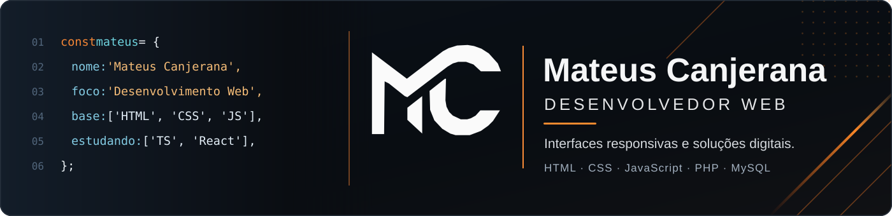
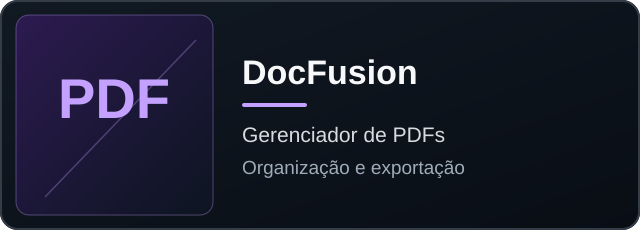
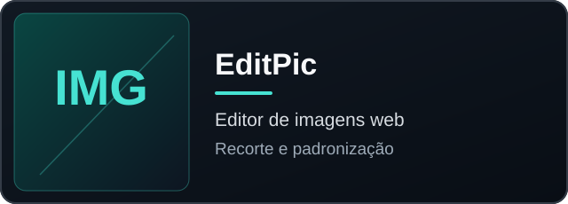
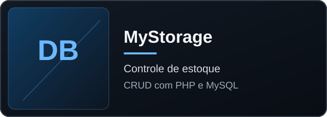
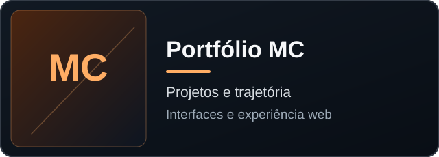

  
    
  
  
  

## Sobre mim

Sou **bacharel em Ciência da Computação** e atualmente concentro meus estudos e projetos no **desenvolvimento web**. Desenvolvo interfaces responsivas e funcionalidades interativas com HTML, CSS e JavaScript, buscando unir clareza visual, usabilidade e organização do código.

Entre meus projetos estão o **EditPic**, voltado à edição e padronização de imagens; o **DocFusion**, para manipulação de documentos PDF; e o **MyStorage**, um sistema de controle de estoque com PHP e MySQL. Utilizo Git e GitHub para organizar e versionar meu trabalho.

🎓 **Formação:** Bacharel em Ciência da Computação  
🎯 **Foco atual:** Desenvolvimento Web e aplicações JavaScript  
📚 **Em aprofundamento:** TypeScript, Node.js, React e fundamentos de Engenharia de Software

## Projetos em destaque

<table>
  <tr>
    <td width="50%" valign="top">
      
       <b>DocFusion</b>
       Aplicação para importar, organizar e exportar documentos PDF diretamente no navegador.
       HTML · CSS · JavaScript · PDF.js · pdf-lib
        <a href="https://github.com/mateuscanjerana/DocFusion">Código</a> · <a href="https://mateuscanjerana.github.io/DocFusion/">Versão online</a>
    </td>
    <td width="50%" valign="top">
      
       <b>EditPic</b>
       Ferramenta web para recortar, redimensionar e padronizar imagens.
       HTML · CSS · JavaScript · Canvas API
        <a href="https://github.com/mateuscanjerana/EditPic">Código</a> · <a href="https://mateuscanjerana.github.io/EditPic/">Versão online</a>
    </td>
  </tr>
  <tr>
    <td width="50%" valign="top">
      
       <b>MyStorage</b>
       Sistema de controle de estoque com operações CRUD e integração com banco de dados.
       PHP · MySQL · Bootstrap
        <a href="https://github.com/mateuscanjerana/mystorage">Ver repositório</a>
    </td>
    <td width="50%" valign="top">
      
       <b>Portfólio MC</b>
       Minha apresentação profissional, projetos, competências e trajetória em desenvolvimento web.
       HTML · CSS · JavaScript
        <a href="https://github.com/mateuscanjerana/meu-portifolio">Código</a> · <a href="https://mateuscanjerana.github.io/meu-portifolio/">Visitar site</a>
    </td>
  </tr>
</table>

## Tecnologias e ferramentas

**Tecnologias que utilizo em projetos**

  

 

**Tecnologias em aprofundamento**

  

## Atividade no GitHub

  <picture>
    <source media="(prefers-color-scheme: dark)" srcset="https://raw.githubusercontent.com/MateusCanjerana/MateusCanjerana/output/github-contribution-grid-snake-dark.svg" />
    <source media="(prefers-color-scheme: light)" srcset="https://raw.githubusercontent.com/MateusCanjerana/MateusCanjerana/output/github-contribution-grid-snake.svg" />
    
  </picture>

---

  <b>Evolução constante, aprendizado aplicado e projetos reais.</b>
   
  Obrigado pela visita! Conheça meus projetos ou entre em contato.

